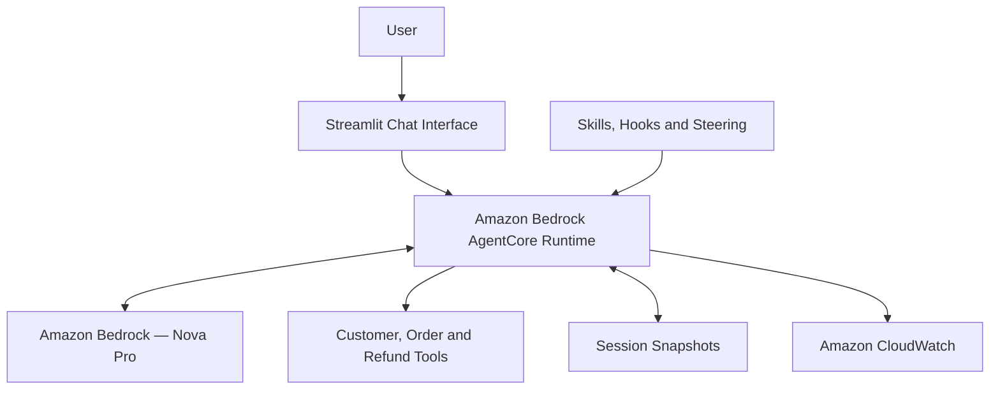

# AWS Customer Support Agent

An AI customer support assistant built with **Strands Agents, Amazon Bedrock, and Amazon Bedrock AgentCore**, with a **Streamlit chat interface**.

The assistant retrieves customer information, answers order enquiries, and handles simulated refund requests. It combines model-driven tool selection with code-based workflow controls and conversation persistence.

## Features

- **Customer lookup:** retrieves customer details from a synthetic dataset.
- **Order enquiries:** returns order information, delivery status, and prices.
- **Refund simulation:** validates order ownership, delivery status, and refund amount.
- **Tool-call controls:** limits each tool to three attempts per invocation.
- **Workflow steering:** requires customer and order lookups before executing a refund simulation.
- **Reusable skills:** loads refund instructions from a dedicated `SKILL.md` file.
- **Conversation continuity:** saves and restores context using session snapshots.
- **Browser interface:** provides a Streamlit chat page connected to the deployed agent.
- **Cloud observability:** captures execution traces and logs in CloudWatch.

## Architecture



The Streamlit server sends messages to AgentCore using the AWS SDK.
The deployed Strands agent manages the model and tool interactions,
then returns a response to the chat interface.

AWS credentials remain on the server. Each browser conversation uses
its own Runtime session ID.

## How a Refund Request Works

1. The customer provides their customer ID, order ID, and refund amount.
2. The agent activates the refund-processing skill.
3. The agent retrieves customer information and order history.
4. Steering intercepts premature refund attempts and guides the agent
   to complete missing lookups.
5. The refund tool checks that the order belongs to the customer,
   has been delivered, and supports the requested amount.
6. The assistant returns a clearly labelled simulation result.

Hooks count tool attempts throughout the request and block attempts
beyond the configured limit.

## Technology Stack

| Component | Technology |
|---|---|
| Language | Python 3.13 |
| Agent framework | Strands Agents |
| Language model | Amazon Nova Pro through Amazon Bedrock |
| Agent hosting | Amazon Bedrock AgentCore Runtime |
| Web interface | Streamlit |
| AWS integration | Boto3 |
| Session storage | SnapshotSessionManager with LocalFileStorage |
| Observability | Amazon CloudWatch |
| Deployment | AgentCore CLI with CDK and CodeZip |

## Project Structure

| Path | Purpose |
|---|---|
| `agent.py` | Local interactive agent |
| `customer_service_tools.py` | Customer lookup, order history, and refund tools |
| `hooks.py` | Tool-call limits |
| `steering_handlers.py` | Refund workflow controls |
| `skills/refund-processing/SKILL.md` | Refund-processing instructions |
| `support_ui.py` | Streamlit chat application |
| `requirements.txt` | Local application dependencies |
| `csdeploy/app/SupportAgent/` | Deployable agent application |
| `csdeploy/agentcore/` | AgentCore configuration and infrastructure |

The outer Python files support local development. The application
inside `csdeploy/app/SupportAgent/` is packaged for deployment.

Changes to shared agent logic must also be applied to the deployment
copy before rebuilding.

## Run the Chat Interface

### Prerequisites

- Python 3.13
- An authenticated AWS profile
- A deployed AgentCore Runtime
- Permission to invoke that Runtime

### Install Dependencies

```powershell
python -m venv .venv
.\.venv\Scripts\Activate.ps1
python -m pip install -r requirements.txt
```

### Configure AWS Access

Replace the Runtime ARN with the ARN from your deployment.

```powershell
$env:AWS_PROFILE = 'bedrock-lab'
$env:AWS_REGION = 'us-east-1'
$env:AGENTCORE_RUNTIME_ARN = '<your-runtime-arn>'
```

### Start the Application

```powershell
python -m streamlit run support_ui.py --server.address 127.0.0.1
```

Open [http://localhost:8501](http://localhost:8501).

The web interface runs locally and sends requests to the agent hosted
in AWS.

## Deploy to AgentCore

Deployment requires Node.js, uv, AgentCore CLI, and an authenticated
AWS identity with deployment permissions.

From the project root:

```powershell
Set-Location .\csdeploy

npm.cmd install --prefix .\agentcore\cdk
uv sync --project .\app\SupportAgent --python 3.13

agentcore.cmd build
agentcore.cmd deploy
agentcore.cmd status --json
```

The deployment packages the Python application and provisions its AWS
infrastructure. AWS service usage incurs charges.

## Example Prompts

**Customer and order information**

> My customer ID is C-1001. Show my recent orders.

**Refund workflow**

> First activate refund-processing. Simulate a USD 25 refund for
> ORD-5521 for customer C-1001.

**Conversation follow-up**

> Which order and refund amount did we discuss?

Select **New conversation** in the interface to start a separate session.

## Project Scope

This project uses fictional customer records and simulated refunds.
No real payments are processed or balances changed. Customer IDs are
demo inputs, not an authentication mechanism.

Session snapshots demonstrate conversation continuity. In AgentCore,
they use temporary storage and may be lost when the Runtime environment
is replaced.

## Acknowledgements

The agent implementation adapts patterns and sample code from the
[AWS Strands Agents hands-on workshop](https://github.com/aws-samples/sample-strands-agents-hands-on-workshop),
with customized customer data, validation, prompts, workflow controls,
deployment configuration, and a Streamlit interface.